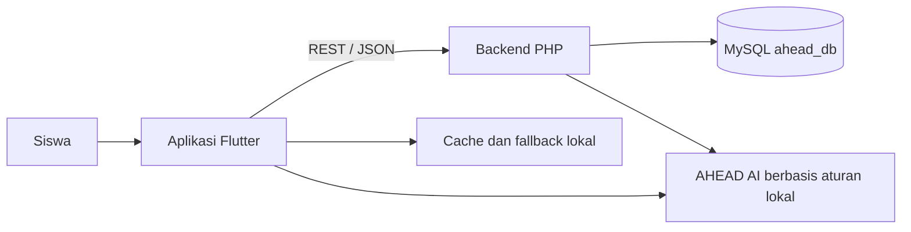
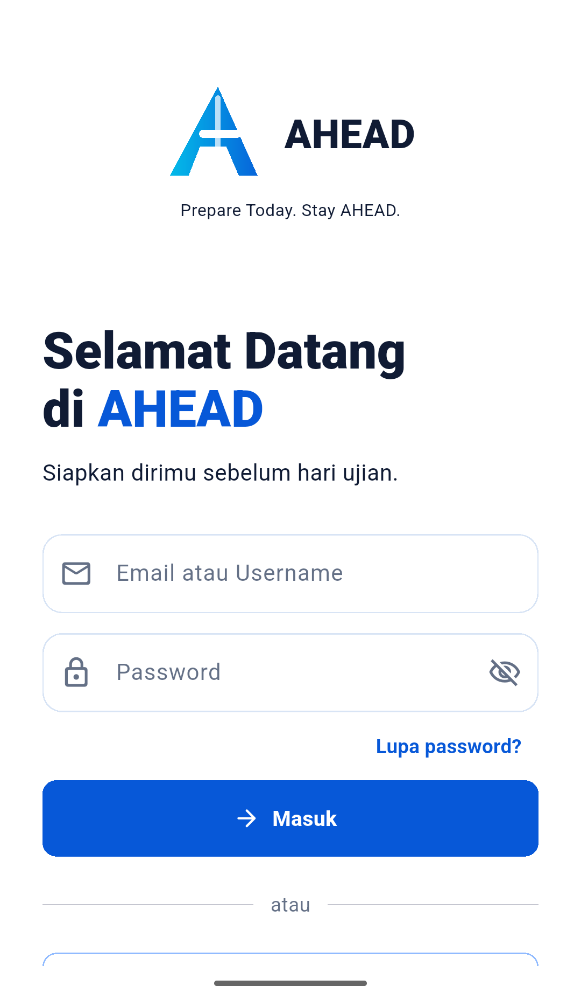
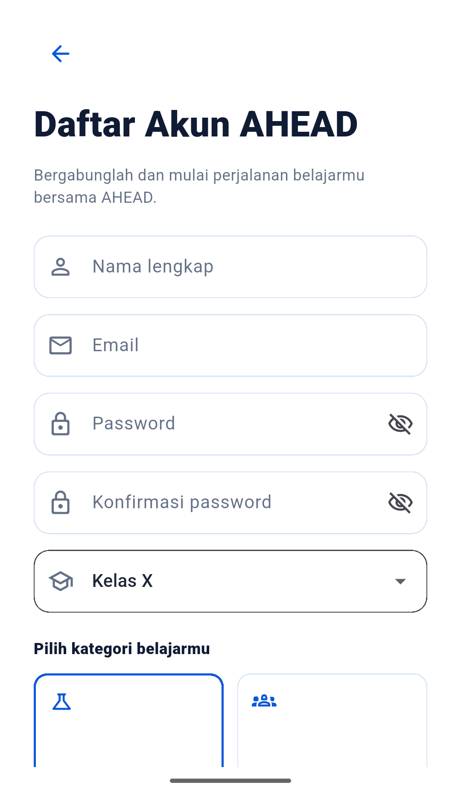
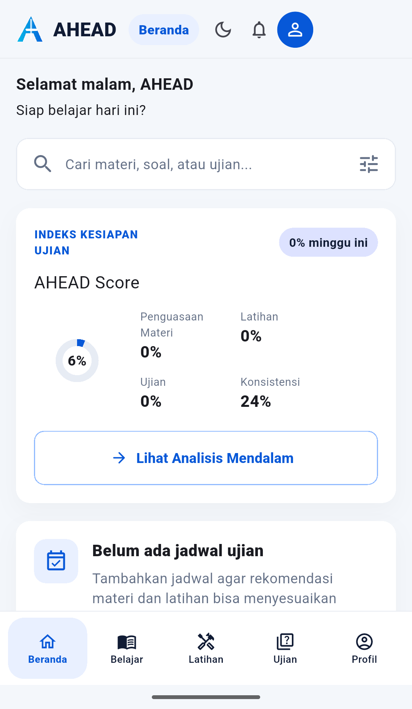
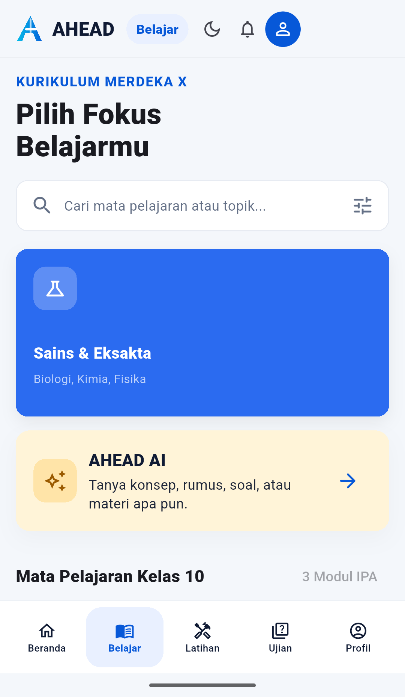
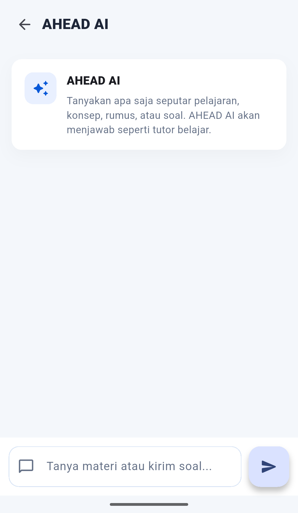
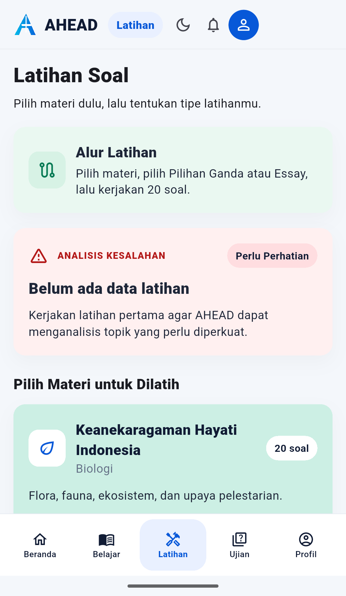
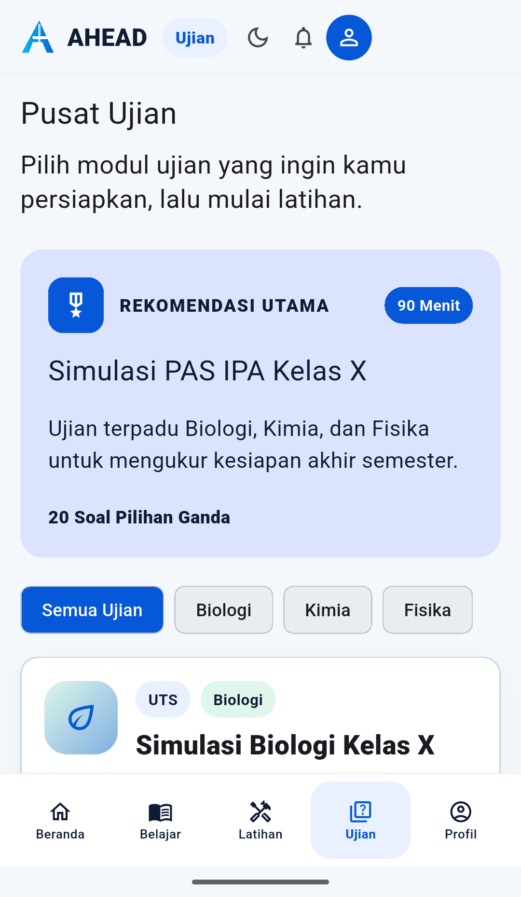

# AHEAD — Aplikasi Pembelajaran Kelas X

AHEAD adalah aplikasi pembelajaran untuk siswa kelas X yang menggabungkan materi, latihan, simulasi ujian, jadwal target, pemantauan progres, dan tutor belajar dalam satu aplikasi Flutter. Proyek ini menggunakan backend PHP dan database MySQL untuk alur data yang didukung server, serta penyimpanan lokal sebagai cache dan fallback pengembangan.

> **Status AI:** AHEAD AI yang tersedia saat ini memakai pencocokan kata kunci dan aturan lokal. Fitur ini belum terhubung ke Gemini atau layanan AI cloud.

## Daftar Isi

- [Tentang AHEAD](#tentang-ahead)
- [Fitur Utama](#fitur-utama)
- [Teknologi](#teknologi)
- [Gambaran Arsitektur](#gambaran-arsitektur)
- [Struktur Proyek](#struktur-proyek)
- [Persiapan](#persiapan)
- [Cara Menjalankan](#cara-menjalankan)
- [Endpoint Backend](#endpoint-backend)
- [Dokumentasi Tampilan](#dokumentasi-tampilan)
- [Catatan Implementasi](#catatan-implementasi)
- [Perintah Pengembangan](#perintah-pengembangan)
- [Kontributor](#kontributor)

## Tentang AHEAD

AHEAD dibuat untuk membantu siswa belajar lebih terarah. Siswa dapat membuka materi pelajaran, mencoba soal, melihat ringkasan kesiapan belajar, dan menyiapkan ujian dari tampilan yang sama. Antarmuka dirancang untuk digunakan pada layar ponsel dan juga dapat dijalankan sebagai aplikasi Flutter Web di komputer.

## Fitur Utama

### 1. Akun dan profil siswa

- Daftar dan masuk dengan email dan password.
- Menyimpan profil siswa, termasuk kelas dan pilihan kelompok belajar IPA atau IPS.
- Login manual mencoba memakai backend ketika API tersedia.
- Pada lingkungan pengembangan, aplikasi memiliki fallback lokal untuk alur akun tertentu. Data fallback hanya berada pada perangkat/browser itu dan tidak otomatis tersinkron ke perangkat lain.
- Login Google tersedia setelah OAuth Client ID dikonfigurasi pada Google Cloud dan backend.

### 2. Materi belajar

- Menampilkan fokus belajar dan mata pelajaran kelas X.
- Menyediakan kategori materi IPA dan IPS sesuai data yang tersedia.
- Mendukung pencarian materi atau topik.
- Menampilkan detail materi untuk membantu siswa mempelajari konsep.

### 3. Latihan soal

- Memilih materi sebelum memulai latihan.
- Menyediakan tipe latihan pilihan ganda dan essay.
- Memberi hasil dan pembahasan sesuai soal yang dikerjakan.
- Menampilkan ringkasan kesalahan dan topik yang perlu dipelajari kembali ketika data latihan tersedia.

### 4. Pusat ujian dan jadwal

- Menampilkan modul simulasi ujian berdasarkan mata pelajaran.
- Menyediakan informasi jumlah soal dan durasi ujian.
- Memungkinkan siswa mengatur jadwal ujian sebagai target belajar.
- Menggunakan jadwal dan progres sebagai masukan rekomendasi belajar yang tersedia di aplikasi.

### 5. Dashboard dan progres

- Merangkum AHEAD Score, penguasaan materi, latihan, ujian, dan konsistensi.
- Menampilkan ringkasan target ujian terdekat.
- Menyediakan pintasan menuju analisis belajar yang lebih rinci.

### 6. AHEAD AI

- Menjawab pertanyaan belajar umum tentang sejumlah topik yang dikenali aplikasi.
- Memberi penjelasan konsep, rumus, dan pembahasan soal melalui respons yang telah disusun pada kode.
- Implementasi saat ini bersifat lokal dan berbasis aturan/kata kunci. Endpoint backend /ai/chat juga mengembalikan respons tutor lokal.
- Belum menggunakan Gemini, OpenAI, atau model cloud. Mengisi OPENAI_API_KEY saja tidak mengaktifkan layanan cloud pada implementasi sekarang.

## Teknologi

| Bagian | Teknologi |
| --- | --- |
| Aplikasi | Flutter dan Dart |
| Android | Flutter Android runner, Android SDK, dan ADB |
| Web | Flutter Web dan Chrome |
| API | PHP native dengan endpoint JSON |
| Database | MySQL, disiapkan untuk Laragon pada lingkungan pengembangan |
| Login Google | Paket google_sign_in; perlu OAuth Client ID |
| Tutor AHEAD AI | Pencocokan aturan dan kata kunci lokal |

## Gambaran Arsitektur



Backend menjadi penyimpanan terpusat untuk permintaan yang berhasil diproses oleh API. Cache/fallback lokal ditujukan untuk pengembangan pada perangkat yang sama; data lokal tidak otomatis menyatu dengan database atau perangkat lain.

## Struktur Proyek

```text
Ahead/
├── android/                     # Konfigurasi aplikasi Android
├── backend/
│   ├── public/index.php         # Router dan endpoint API PHP
│   ├── sql/schema.sql           # Skema database ahead_db
│   ├── .env.example             # Contoh konfigurasi lokal
│   └── README.md                # Panduan backend
├── docs/
│   └── images/                  # Screenshot dokumentasi README
├── lib/
│   └── ahead_shell_app.dart     # UI, state, dan alur aplikasi Flutter
├── test/                        # Berkas pengujian Flutter
├── JALANKAN_AHEAD.bat           # Menjalankan API dan Flutter Web di Windows
├── JALANKAN_AHEAD_HP.bat        # Menjalankan aplikasi pada perangkat Android
├── run_ahead.ps1                # Proses launcher web
├── run_ahead_android.ps1         # Proses launcher Android dan ADB reverse
├── SETUP_GOOGLE_LOGIN.md        # Pengaturan Google Sign-In
└── pubspec.yaml                 # Dependensi Flutter
```

## Persiapan

Siapkan perangkat lunak berikut:

- Git.
- Flutter SDK dan Dart.
- PHP yang dapat dijalankan dari terminal atau Laragon.
- MySQL; konfigurasi launcher saat ini mengarah ke instalasi Laragon.
- Chrome untuk menjalankan mode Web.
- Android Studio/Android SDK untuk emulator atau perangkat Android.
- Untuk ponsel fisik: kabel USB dan USB debugging yang sudah diizinkan.

### Siapkan database dan backend

1. Buka Laragon dan aktifkan MySQL.
2. Buat skema database dengan mengimpor backend/sql/schema.sql. Skrip tersebut membuat database ahead_db beserta tabel yang diperlukan.
3. Salin backend/.env.example menjadi backend/.env.
4. Sesuaikan DB_HOST, DB_PORT, DB_DATABASE, DB_USERNAME, DB_PASSWORD, dan JWT_SECRET dengan konfigurasi lokal.
5. Jangan mengunggah backend/.env atau nilai rahasia ke GitHub. File tersebut sudah dikecualikan melalui .gitignore.

Contoh impor melalui MySQL CLI (sesuaikan opsi pengguna/password dengan instalasi lokal):

```powershell
Get-Content .\backend\sql\schema.sql | mysql -u root
```

Pengiriman email reset password belum aktif secara otomatis. Endpoint membuat token pengembangan; pengiriman token melalui email memerlukan implementasi dan konfigurasi SMTP.

### Konfigurasi Google Sign-In (opsional)

Google Sign-In membutuhkan OAuth Client ID yang sesuai dengan platform dan diverifikasi backend. Ikuti [panduan konfigurasi Google](SETUP_GOOGLE_LOGIN.md). Tanpa Client ID yang benar, tombol Google belum dapat menyelesaikan proses login.

## Cara Menjalankan

Jalankan perintah dari folder hasil clone.

### Pilihan A — Flutter Web di Windows

1. Siapkan database dan backend/.env mengikuti bagian di atas.
2. Jalankan JALANKAN_AHEAD.bat.
3. Launcher memeriksa MySQL, memulai API PHP di http://127.0.0.1:8000, lalu menjalankan Flutter Web di Chrome pada port 64800.
4. Buka http://localhost:64800 bila browser tidak terbuka otomatis.

### Pilihan B — Android Emulator atau ponsel melalui USB

1. Siapkan database dan backend/.env.
2. Jalankan emulator Android atau hubungkan ponsel dengan USB debugging aktif.
3. Pastikan perangkat muncul saat menjalankan flutter devices.
4. Jalankan JALANKAN_AHEAD_HP.bat.
5. Jika ada beberapa perangkat, masukkan ID perangkat yang ingin digunakan.
6. Biarkan terminal launcher tetap berjalan selama aplikasi dipakai. Hentikan sesi dengan Ctrl+C.

Launcher Android mengatur adb reverse tcp:8000 tcp:8000 agar aplikasi pada emulator/ponsel dapat mengakses API lokal komputer. Untuk menggunakan API dari perangkat Android yang dijalankan manual, jalankan reverse tersebut sebelum flutter run.

### Lokasi instalasi yang dipakai launcher

Launcher disiapkan untuk lingkungan Windows pengembangan ini. Lokasi default yang dipakai skrip adalah MySQL Laragon di C:\laragon\bin\mysql\mysql-8.4.11-winx64, PHP di C:\laragon\bin\php\php-8.4.25, dan ADB di C:\Android\SDK\platform-tools\adb.exe. Jika instalasi Anda berbeda, sesuaikan variabel path di run_ahead.ps1 dan run_ahead_android.ps1. Launcher Web memakai port tetap 64800, sedangkan API memakai port 8000.

## Endpoint Backend

Endpoint utama yang tersedia di backend/public/index.php:

| Method | Endpoint | Kegunaan |
| --- | --- | --- |
| GET | /health | Memeriksa kesehatan API |
| POST | /auth/register | Membuat akun |
| POST | /auth/login | Login email/password |
| POST | /auth/google | Memverifikasi token Google |
| POST | /auth/logout | Mengakhiri sesi token |
| POST | /password/forgot | Membuat token reset password |
| POST | /password/reset | Mengganti password menggunakan token |
| GET | /me | Mengambil profil pengguna aktif |
| GET | /subjects | Mengambil mata pelajaran |
| GET | /materials | Mengambil materi belajar |
| GET | /exams | Mengambil daftar ujian |
| GET | /dashboard | Mengambil ringkasan progres |
| POST | /ai/chat | Meminta respons tutor lokal berbasis aturan |

## Dokumentasi Tampilan

Screenshot berikut diambil dari AHEAD yang berjalan pada emulator Android. Beberapa halaman dapat digulir ke bawah untuk melihat seluruh isi.

### 1. Login dan pendaftaran

<p align="center">
  
  &nbsp;&nbsp;
  
</p>
<p align="center"><sub>Masuk ke AHEAD atau buat akun baru dan pilih kelompok belajar.</sub></p>

### 2. Beranda dan ringkasan progres

<p align="center">
  
</p>
<p align="center"><sub>Beranda menampilkan pencarian, indeks kesiapan ujian, AHEAD Score, serta ringkasan jadwal.</sub></p>

### 3. Belajar dan AHEAD AI

<p align="center">
  
  &nbsp;&nbsp;
  
</p>
<p align="center"><sub>Menu belajar berisi fokus dan mata pelajaran. AHEAD AI menampilkan ruang tanya-jawab tutor lokal.</sub></p>

### 4. Latihan soal dan pusat ujian

<p align="center">
  
  &nbsp;&nbsp;
  
</p>
<p align="center"><sub>Latihan mengarahkan siswa memilih materi dan tipe soal; pusat ujian menampilkan simulasi serta filter mata pelajaran.</sub></p>

## Catatan Implementasi

- Login manual mencoba memakai API saat backend tersedia. Fallback akun lokal mendukung pengembangan pada browser/perangkat yang sama; fallback tersebut bukan sinkronisasi server.
- Google Sign-In memerlukan Client ID OAuth yang cocok. Paket Flutter saja belum cukup untuk mengaktifkan autentikasi Google.
- Reset password belum mengirim email tanpa integrasi SMTP.
- AHEAD AI saat ini menggunakan respons lokal berbasis aturan. Jangan menganggap fitur tersebut sebagai Gemini atau AI cloud.
- Untuk menggunakan aplikasi pada Android bersama backend lokal komputer, jalankan launcher Android agar ADB reverse dipasang otomatis.

## Perintah Pengembangan

```powershell
flutter pub get
flutter devices
flutter run -d chrome --web-port 64800
flutter analyze
flutter test
```

flutter analyze dan flutter test tersedia untuk pemeriksaan proyek; hasil pemeriksaan terbaru tidak dinyatakan pada dokumentasi ini.

## Kontributor

Dikembangkan pada repositori [tirekbauamis-commits/Ahead](https://github.com/tirekbauamis-commits/Ahead).